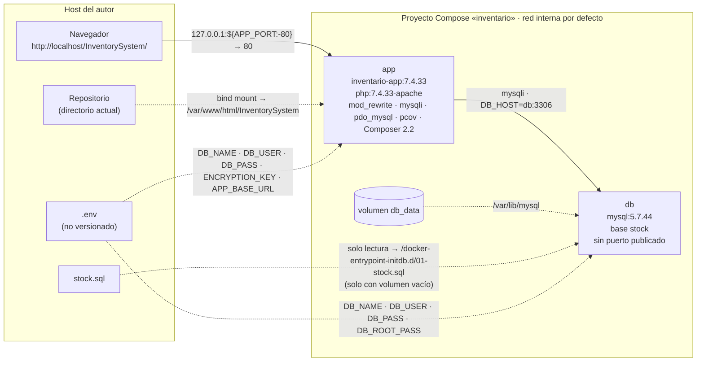

# Despliegue del entorno de staging (Docker)

Describe el entorno **real** definido en [`docker-compose.yml`](../../docker-compose.yml) y [`docker/app/Dockerfile`](../../docker/app/Dockerfile). Resuelve la observación O-05 (XAMPP frente a Docker): el README heredado del proyecto original (eliminado en el commit `bef9e17`) indicaba instalar con XAMPP en `C:\xampp\htdocs\InventorySystem`; el entorno de la iteración es Docker.

## Diagrama



## Servicios, puertos y volúmenes

| Servicio | Imagen | Puerto publicado | Montajes y volúmenes | Variables (desde `.env`) |
| :---- | :---- | :---- | :---- | :---- |
| `app` | `inventario-app:7.4.33`, construida desde `docker/app/` sobre `php:7.4.33-apache` | `127.0.0.1:${APP_PORT:-80}:80` (solo el host local) | `./` → `/var/www/html/InventorySystem` | `CI_ENV`, `DB_HOST=db`, `DB_NAME`, `DB_USER`, `DB_PASS`, `ENCRYPTION_KEY`, `APP_BASE_URL` |
| `db` | `mysql:5.7.44` | Ninguno | volumen `db_data` → `/var/lib/mysql`; `./stock.sql` → `/docker-entrypoint-initdb.d/01-stock.sql` (solo lectura) | `MYSQL_DATABASE`, `MYSQL_USER`, `MYSQL_PASSWORD`, `MYSQL_ROOT_PASSWORD` |

## Correspondencia con el informe

- Versiones: Tabla 2 (PHP 7.4.33, Apache 2.4, MySQL 5.7.x).
- Staging en Docker con MySQL 5.7: Tabla 9 de pruebas.
- Base de datos sin puerto publicado y aplicación solo en `127.0.0.1`: Tabla 13 de seguridad ("Firewall" y "Contenedores de staging").
- Credenciales en `.env`, fuera del repositorio; `.env.example` sin valores reales: Tabla 13 de seguridad ("Secretos en el repositorio").

## Verificación

```bash
docker compose config        # servicios, puertos y volúmenes resueltos
docker compose ps            # app en 127.0.0.1:80->80/tcp; db sin puertos publicados
```
